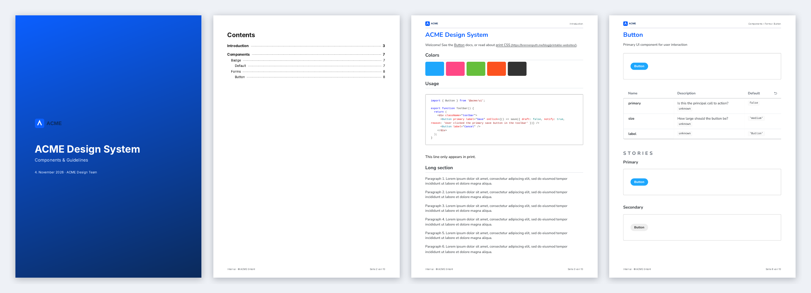

# storybook-pdf-export

<p align="center">
  <a href="https://www.npmjs.com/package/storybook-pdf-export"></a>
  
  
  
  
  
  
  <a href="LICENSE"></a>
</p>

<p align="center">
  <b>Your whole Storybook as one PDF.</b><br>
  Cover, table of contents, bookmarks, page numbers and working links, in your corporate design.<br>
  One command. Runs locally. Works with any Storybook build.
</p>

<p align="center">
  
</p>

<p align="center">
  Built by <a href="https://github.com/artursopelnik"><b>Artur Sopelnik</b></a>
</p>

---

## What is this?

Storybook and Chromatic **don't have a built-in way to export a whole Storybook or design system as a PDF.** Hitting <kbd>Ctrl</kbd>+<kbd>P</kbd> prints one page at a time, and the result is missing parts, cut off, or looks like a screenshot of a web app.

Still, a PDF is often exactly what people need:

> "Can you send the design system documentation to the agency?"
> "Legal needs a frozen copy of the component guidelines for release 3.2."
> "I want to read the docs on paper and mark them up."
> "Attach the UI specs to the tender."

**storybook-pdf-export** turns your Storybook into one clean, navigable PDF:

```bash
npx storybook-pdf-export ./storybook-static -o design-system.pdf
```

That's it. Every docs page (MDX and autodocs) ends up in the file, in sidebar order, with:

- 📘 a **cover page** and a **table of contents** with clickable page numbers
- 🔖 **PDF bookmarks** that mirror your Storybook sidebar
- 🔗 **working links**: `[Button](?path=/docs/button--docs)` in your MDX jumps to the right page in the PDF
- 🔢 **page numbers** and the current section in the footer
- 🖨️ a **print stylesheet** for Storybook's docs blocks: readable type, code that doesn't get cut off, stories that don't break across pages, and no zoom buttons or "Copy code" chrome
- 🎨 **your corporate design**: colors, fonts, logo, your own cover, header, footer and back page

---

## Quick start

```bash
npm i -D storybook-pdf-export
npx playwright install chromium   # once, unless you pass --chromium

npx storybook build
npx storybook-pdf-export          # → storybook.pdf
```

It also works against a running Storybook:

```bash
npx storybook-pdf-export http://localhost:6006 -o docs.pdf
```

### Let your AI set it up

Using **Claude Code** or **Cursor**? Open your project and say:

> "Add storybook-pdf-export to this project: export the PDF after every Storybook build into storybook-static, and add the addon so there's a download button in the toolbar."

> "Create a storybook-pdf.config.js in our corporate design: logo from ./brand/logo.svg, primary color #0b5fff, font Inter, footer 'Internal · © ACME'."

Everything here is plain config and CLI flags, so an assistant can wire it up from this README.

---

## Ctrl+P vs Chromatic vs storybook-pdf-export

|                                        | Browser print (Ctrl+P) | Chromatic        | **storybook-pdf-export** |
| -------------------------------------- | :--------------------: | :--------------: | :----------------------: |
| Whole Storybook in one file            | ✗ one page at a time   | ✗ no PDF export  | **✓**                    |
| Table of contents + bookmarks          | ✗                      | ✗                | **✓**                    |
| Links between docs pages work          | ✗                      | ✗                | **✓**                    |
| Print-optimized docs blocks            | ✗                      | ✗                | **✓**                    |
| Corporate design (cover, header, footer) | ✗                    | ✗                | **✓**                    |
| Runs locally / in CI, no account       | ✓                      | ✗ cloud service  | **✓**                    |

---

## Corporate design: themes, templates and hooks

The PDF should look like *your* document, not like ours. Customization has three levels, and you can use as much or as little as you want. Put everything in a **`storybook-pdf.config.js`** in your project root. The CLI picks it up automatically, or you pass `--config path`.

### 1. Theme: colors, fonts, logo

Usually enough:

```js
// storybook-pdf.config.js
import { defineConfig } from 'storybook-pdf-export';

export default defineConfig({
  title: 'ACME Design System',
  subtitle: 'Components & Guidelines',
  theme: {
    accentColor: '#0b5fff',
    fontCss: "@import url('https://fonts.googleapis.com/css2?family=Inter:wght@400;700&display=swap');",
    fontFamily: 'Inter, Arial, sans-serif',
    logo: './brand/logo.svg',   // svg, png, jpg, webp; relative to the config file
    locale: 'de-DE',            // date format on the cover
  },
});
```

| theme key     | default             | used for                                            |
| ------------- | ------------------- | --------------------------------------------------- |
| `accentColor` | `#ff4785`           | Cover bar, TOC headings → `var(--pdf-accent)`        |
| `textColor`   | `#1b1b1b`           | Text of generated pages → `var(--pdf-text)`          |
| `mutedColor`  | `#73777b`           | Footer, meta lines → `var(--pdf-muted)`              |
| `fontFamily`  | Nunito Sans, system | Generated pages → `var(--pdf-font)`                  |
| `fontCss`     | –                   | `@import` / `@font-face` for your web fonts          |
| `logo`        | –                   | Cover and header (inlined as data URI)               |
| `locale`      | `en-GB`             | Date on the cover                                    |

### 2. Templates: your own HTML

The cover, table of contents, running header and footer, and an optional back page are **plain functions that return HTML**. Override the ones you want. Return `''` to leave something out.

```js
export default defineConfig({
  templates: {
    // Extra CSS for all generated pages
    css: `.cover { background: linear-gradient(160deg, #0b5fff, #0b2a5b); color: #fff; border: 0; }`,

    // Logo + current component at the top of every content page
    header: (ctx) => ctx.kind === 'content'
      ? `<div class="running header"><span>${ctx.esc(ctx.section)}</span></div>`
      : '',

    // ctx.kind is 'cover' | 'toc' | 'content' | 'back'
    footer: (ctx) => ctx.kind === 'cover' ? '' :
      `<div class="running footer"><span>Internal · © ACME GmbH</span><span>Seite ${ctx.pageNumber} von ${ctx.total}</span></div>`,

    // Imprint / contact as the last page
    back: (ctx) => `<section style="padding-top:200mm"><p>ACME GmbH · design@acme.example</p></section>`,

    // cover: (ctx) => `...`,
    // toc:   (ctx) => `...`,   // ctx.tree / ctx.items: [{ label, depth, page, href, children }]
  },
});
```

**What templates get (`ctx`):** `title`, `subtitle`, `author`, `version` (from your package.json), `date`, `dateText`, `logo`, `theme`, `entries`, `esc()` for HTML escaping.
Header and footer also get `kind`, `pageNumber`, `total`, `section` and `entry`. The TOC gets `tree` and `items`, and each `href` becomes an internal PDF link.

Header and footer are rendered by Chromium and laid over each page, so **web fonts, SVG logos and any CSS** work there too. The cover gets the full sheet without margins, so full-bleed backgrounds work. Want to start from the defaults? `import { templates } from 'storybook-pdf-export'`.

### 3. Hooks: step into the pipeline

```js
export default defineConfig({
  hooks: {
    // Reorder / filter pages: (entries, fullIndex) => entries
    filterEntries: (entries) => entries.filter((e) => !e.title.startsWith('Deprecated')),

    // Playwright page, after Storybook rendered, before printing
    beforeRender: async ({ page, entry }) => {
      await page.addStyleTag({ content: '.sbdocs h1 { color: #0b5fff !important; }' });
    },

    // Raw PDF bytes of one entry: return new bytes to replace them
    afterRender: async ({ entry, pdf }) => pdf,

    // Final pdf-lib document: watermarks, attachments, metadata, …
    beforeSave: async ({ doc, PDFLib, entries, startPages }) => {
      doc.setKeywords(['design system']);
    },
  },
});
```

A complete example lives in [`examples/corporate`](examples/corporate/storybook-pdf.config.js). It produced the PDF in the preview above.

---

## Addon: print button and PDF download in Storybook

Make the PDF available right where people read your docs:

```js
// .storybook/main.js
export default {
  addons: [
    '@storybook/addon-docs',
    { name: 'storybook-pdf-export', options: { pdfUrl: 'storybook.pdf' } },
  ],
};
```

```json
{
  "scripts": {
    "build-storybook": "storybook build && storybook-pdf-export storybook-static -o storybook-static/storybook.pdf"
  }
}
```

The toolbar gets two buttons:

- 🖨️ **Print this page.** Prints the current docs page with the print stylesheet.
- ⬇️ **Download PDF.** Only shown when the PDF actually exists in the deployed build.

| option     | default           | description                                         |
| ---------- | ----------------- | --------------------------------------------------- |
| `pdfUrl`   | `"storybook.pdf"` | Location of the PDF, relative to the Storybook root |
| `printCss` | `true`            | Inject the print stylesheet into the preview        |

---

## The print stylesheet

`print.css` is used for the export and for the toolbar's print button. It follows the ideas from [“Websites Should Be Printable”](https://brennenputh.me/blog/printable-websites/) and applies them to Storybook's docs blocks:

- **Fixed point sizes** (11pt body, 20/15/13pt headings) instead of screen-relative sizes
- **Black, underlined links.** External links get their URL printed after them, because paper can't be clicked.
- **Code blocks** stay in one piece when they fit on a page, and long lines wrap instead of being cut off
- **Story previews, table rows and images** never split across pages, and headings are never left alone at the bottom of a page
- **Interactive chrome hidden:** zoom toolbar, "Copy code", the controls column of the ArgTypes table
- **Colors kept** (`print-color-adjust: exact`), so color swatches and token tables survive

Utility classes for your MDX and components:

| class               | effect                          |
| ------------------- | ------------------------------- |
| `.sb-no-print`      | Hidden in print / PDF           |
| `.sb-print-only`    | Only visible in print / PDF     |
| `.sb-page-break`    | Starts a new page               |
| `.sb-keep-together` | Never split across pages        |

```mdx
<div className="sb-print-only">
  Printed version. For the latest docs see design.acme.com.
</div>
```

Add your own rules with `--css my-print.css` (or `css: [...]` in the config).

---

## Choosing what goes into the PDF

| `--mode`  | what ends up in the PDF                                          |
| --------- | ---------------------------------------------------------------- |
| `auto`    | Docs pages, plus the stories of components that have no docs page (default) |
| `docs`    | Docs pages only (MDX + autodocs)                                 |
| `stories` | Each story on its own page, with a title header                  |
| `all`     | Both                                                             |

```bash
npx storybook-pdf-export -i "Components" -x "Components/Internal" --landscape
```

Filters match the story id, the title (`Components/Forms/Button`) and `title/name`. A pattern also covers everything below it. To keep single stories or whole components out of the PDF, tag them:

```js
export default { title: 'Playground', tags: ['no-pdf'] };
```

---

## CLI reference

```
storybook-pdf-export [source] [options]

  source              Static build directory or URL of a running Storybook (default: ./storybook-static)

  --config            Config file with theme, templates and hooks (default: ./storybook-pdf.config.js)
  -o, --output        Output file                                 (default: storybook.pdf)
  -t, --title         Title on the cover and in the PDF metadata  (default: package name)
      --subtitle      Subtitle on the cover
      --author        Author in the PDF metadata
  -m, --mode          auto | docs | stories | all                 (default: auto)
  -i, --include       Only export matching entries (glob, repeatable)
  -x, --exclude       Skip matching entries (glob, repeatable)
      --css           Extra print stylesheet (repeatable)
      --format        A4, Letter, A3, …                           (default: A4)
      --landscape
      --no-cover / --no-toc / --no-page-numbers
      --storybook-url Public Storybook URL. Links to stories not in the PDF point there.
      --chromium      Use an existing Chrome/Chromium (or env STORYBOOK_PDF_CHROMIUM)
  -c, --concurrency   Pages rendered in parallel                  (default: 4)
      --timeout       Per-page timeout in ms                      (default: 30000)
      --delay         Extra wait per page in ms                   (default: 0)
      --strict        Exit with an error if any page fails to render
  -q, --quiet
```

CLI flags override the config file.

## Node API

```js
import { exportPdf } from 'storybook-pdf-export';

const { pages, entries, failed } = await exportPdf({
  source: './storybook-static',
  output: 'design-system.pdf',
  title: 'ACME Design System',
  theme: { accentColor: '#0b5fff', logo: './logo.svg' },
  templates: { footer: (ctx) => `…` },
  hooks: { beforeSave: ({ doc }) => {} },
  log: console.log,
});
```

All config file keys work here too. Pass `output: null` to get the bytes back without writing a file.

---

## How it works

1. **Serve.** The static build is served on a random local port, because Storybook can't run from `file://`.
2. **Read the index.** It reads `index.json` (or `stories.json` from Storybook 6) and keeps the entries in sidebar order.
3. **Render.** Each entry opens in `iframe.html?id=…&viewMode=docs|story` in headless Chromium (Playwright). It waits for Storybook's `docsRendered` / `storyRendered` event, network idle, fonts, images, and 400 ms without DOM changes. Then it prints with the print stylesheet.
4. **Assemble.** It renders the cover, TOC, back page, header and footer from your templates and merges everything with pdf-lib. TOC entries and `?path=/docs/…` links become internal jumps, and bookmarks are added.

Everything runs on your machine or in your CI. No account, no upload, no API key.

## Known limitations

- Each docs page starts on a new sheet. If a page fills its last sheet almost exactly, Chromium can add an empty page after it.
- The PDF shows each story as it looks after it rendered. Interactive states such as hover or open menus only appear if a story shows them by default.

---

## Contributing

```bash
npm install
npm test
```

Issues and pull requests are welcome.

## License

MIT © [Artur Sopelnik](https://github.com/artursopelnik)
